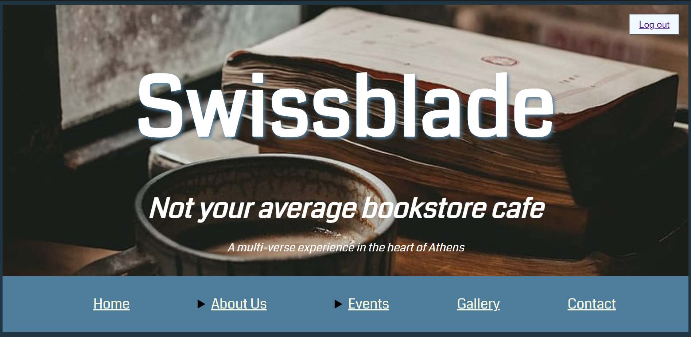

# Swissblade – Coffee&More

A responsive website for a fictional bookstore café in Athens, built with PHP and MySQL. Visitors can create an account, log in, browse the café's menu and events, and book a seat for an event with an optional coupon upload.

<!-- Add a screenshot: save it as images/screenshot.png -->


## Features

- **User accounts**: sign-up with validation and login, using hashed passwords (`password_hash` / `password_verify`) and PHP sessions
- **Single-page café site**: About Us, main area, courtyard, library, opening hours, menu, gallery and contact sections
- **Events**: movie night, wine tasting class and espresso basics class
- **Seat booking**: a form that stores reservations in a MySQL table, with optional coupon file upload
- **Responsive design**: separate stylesheets for mobile (< 600px) and desktop (≥ 600px)

## Tech Stack

PHP · MySQL (MySQLi) · HTML5 · CSS3 · Font Awesome · Google Fonts

## Project Structure

```
├── databases/
│   ├── connect.php      # Connection to the `db1` database (bookings)
│   ├── connect2.php     # Connection to the `db2` database (users)
│   ├── db1.sql          # Schema: BOOKINGS table
│   └── db2.sql          # Schema: users table
├── images/              # Site images and icons
├── includes/
│   ├── login.inc.php    # Login handler
│   ├── logout.php       # Logout handler
│   └── signup.inc.php   # Sign-up handler
├── pages/
│   ├── index.html       # Main site (shown after login)
│   ├── insert.php       # Booking form handler
│   └── signup.php       # Sign-up page
├── stylesheet/
│   ├── desktop.css
│   └── mobile.css
├── uploads/             # Uploaded coupons are saved here
└── loginpage.php        # Entry point (login page)
```

## Getting Started

### Prerequisites

A local PHP + MySQL environment such as [XAMPP](https://www.apachefriends.org/) or WAMP.

### Installation

1. Clone the repository into your web server's root folder (`htdocs` for XAMPP):
   ```bash
   git clone https://github.com/vassfor/webpage.git
   ```
2. Start Apache and MySQL.
3. Open phpMyAdmin (`http://localhost/phpmyadmin`), go to the **Import** tab and import `databases/db1.sql` and `databases/db2.sql`, one after the other. They create the `db1` and `db2` databases and their tables automatically.
4. If your MySQL credentials differ from the XAMPP defaults (`root` with an empty password), update `databases/connect.php` and `databases/connect2.php`.
5. Make sure the `uploads/` folder is writable by the web server.
6. Open `http://localhost/webpage/loginpage.php` in your browser.

## Usage

1. Click **Sign up** and create an account.
2. Log in with your username and password.
3. Browse the site and use the **Book your seat** form to reserve a place at an event.

## Author

**vassfor** – [GitHub](https://github.com/vassfor)
